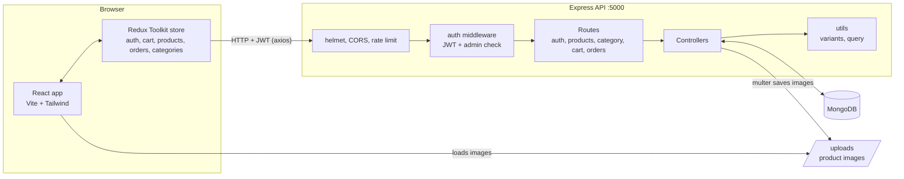
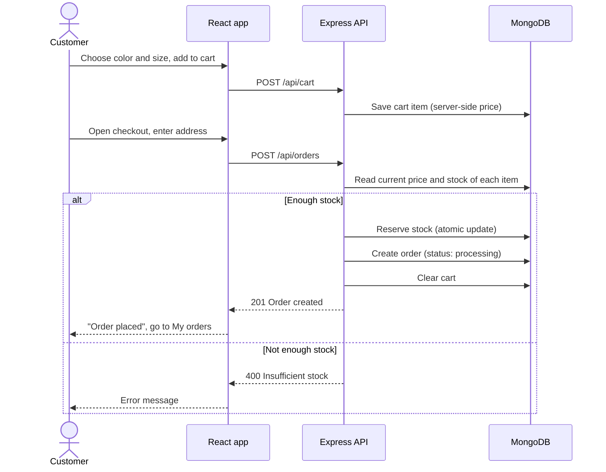
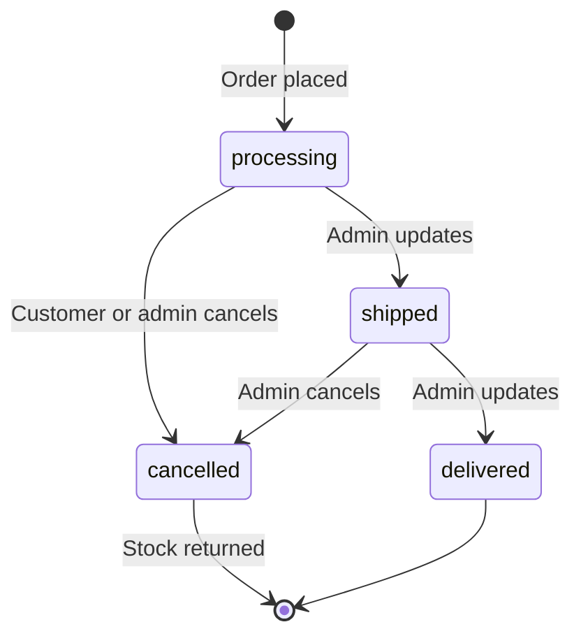
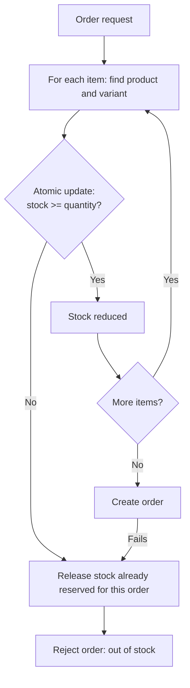
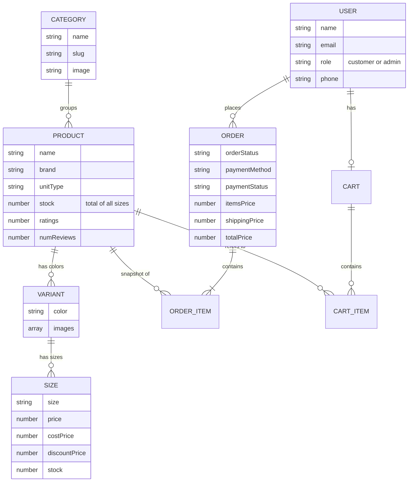

# Bazaaro

A full-stack online store for everyday products, built with the **MERN stack** (MongoDB, Express, React, Node.js). Bazaaro has a **multi-variant inventory system**: every product can have several colors, and every color several sizes, with its own price, stock and photos per size and color. Customers browse, order and pay cash on delivery. Admins manage products, orders and users from a separate dashboard.

  

---

## Table of contents

- [Features](#features)
- [Tech stack](#tech-stack)
- [Architecture](#architecture)
- [How an order flows](#how-an-order-flows)
- [Stock safety](#stock-safety)
- [Data model](#data-model)
- [Project structure](#project-structure)
- [Getting started](#getting-started)
- [Environment variables](#environment-variables)
- [API overview](#api-overview)
- [Security](#security)
- [Roadmap](#roadmap)

---

## Features

**Storefront**
- Home page with categories, featured products, products on sale and top-rated products
- Shop page with search, category, price filters and sorting (latest, price, rating). Filters are kept in the URL
- Product page with color and size selection. Price, stock and photos change with the chosen variant
- Cart that saves automatically, with quantity changes and a free-delivery hint
- Checkout with delivery address. Cash on delivery is available now
- Order history, order details and order cancellation (while the order is still being processed)
- Login, register and profile pages
- Fully responsive (phone, tablet, desktop)

**Admin dashboard**
- Overview with revenue, order, product and category counts and the latest orders
- Products: create, edit and delete, with colors, sizes, prices, stock and multiple photos per color
- Orders: filter by status and update status (processing, shipped, delivered, cancelled)
- Users: view accounts and delete customers

**Inventory**
- Price and stock are stored per size inside each color
- Stock is reserved when an order is placed and returned if the order is cancelled or fails
- Prices are always read from the database on the server, never trusted from the browser

---

## Tech stack

| Layer | Technology |
| --- | --- |
| Frontend | React 19, Vite, Redux Toolkit, React Router, Tailwind CSS, react-hook-form, react-hot-toast |
| Backend | Node.js, Express 4, Mongoose, JWT, bcryptjs, Multer |
| Database | MongoDB |
| Security | helmet, express-rate-limit, CORS allow-list |

---

## Architecture



---

## How an order flows



### Order status



A customer can cancel only while the order is `processing`. A delivered order cannot be cancelled. Cancelling returns the reserved stock.

---

## Stock safety

Two customers can try to buy the last item at the same time. Bazaaro avoids overselling by reserving stock with a single atomic database update that only succeeds while enough stock remains.



---

## Data model



Delivery is free for orders over Rs. 1,000, otherwise Rs. 200.

---

## Project structure

```
bazaaro/
├── client/                     # React app (Vite)
│   ├── public/                 # favicon, placeholder image
│   └── src/
│       ├── components/
│       │   ├── admin/          # shared admin UI (header, table, stat card)
│       │   ├── common/         # Navbar, Footer, Logo, Pagination, dialogs
│       │   └── products/       # ProductCard
│       ├── pages/
│       │   ├── shop/           # Home, Shop, Product detail
│       │   ├── cart/           # Cart
│       │   ├── order/          # Checkout, My orders, Order detail
│       │   ├── auth/           # Login, Register, Profile
│       │   └── admin/          # Dashboard, Products, Orders, Users
│       ├── redux/slices/       # auth, cart, product, order, category
│       ├── services/           # axios instance
│       └── utils/              # image url, price, status helpers
└── server/
    ├── config/                 # database connection
    ├── controller/             # request handlers
    ├── middleware/             # JWT and admin checks
    ├── models/                 # Mongoose schemas
    ├── routes/                 # API routes
    ├── scripts/                # one-time maintenance scripts
    ├── utils/                  # variant stock logic, query helpers
    └── server.js               # app entry point
```

---

## Getting started

**Requirements:** Node.js 22 and MongoDB (local install or Docker).

### 1. Clone

```bash
git clone https://github.com/bilawal-tech/bazaaro.git
cd bazaaro
```

### 2. Start MongoDB

With Docker:

```bash
docker run -d --name bazaaro-mongo -p 27017:27017 mongo:7
```

### 3. Run the server

```bash
cd server
npm install
cp .env.example .env        # Windows PowerShell: copy .env.example .env
```

Open `server/.env` and set `JWT_SECRET`. Generate one with:

```bash
node -e "console.log(require('crypto').randomBytes(48).toString('hex'))"
```

Then start the API:

```bash
npm run dev                 # http://localhost:5000
```

### 4. Run the client

```bash
cd client
npm install
cp .env.example .env        # optional: footer contact and social links
npm run dev                 # http://localhost:5173
```

### 5. Create an admin account

Register a normal account on the website, then change its role in MongoDB:

```bash
docker exec -it bazaaro-mongo mongosh bazaaro --eval 'db.users.updateOne({ email: "you@example.com" }, { $set: { role: "admin" } })'
```

Log in again and the **Admin** bar appears under the navigation.

### Useful commands

| Where | Command | What it does |
| --- | --- | --- |
| `server` | `npm run dev` | Start the API with auto-reload |
| `server` | `npm start` | Start the API |
| `client` | `npm run dev` | Start the Vite dev server |
| `client` | `npm run build` | Production build into `client/dist` |
| `client` | `npm run lint` | Run ESLint |

---

## Environment variables

**Server (`server/.env`)**

| Variable | Required | Description |
| --- | --- | --- |
| `JWT_SECRET` | Yes | Secret used to sign login tokens. The server will not start without it |
| `MONGO_URI` | Yes | MongoDB connection string, for example `mongodb://localhost:27017/bazaaro` |
| `PORT` | No | API port (default `5000`) |
| `JWT_EXPIRES_IN` | No | Token lifetime (default `7d`) |
| `CLIENT_URL` | No | Allowed frontend origin(s), comma separated (default `http://localhost:5173`) |
| `RATE_LIMIT_MAX` | No | Max API requests per IP per 15 minutes (default `600`) |
| `RATE_LIMIT_DISABLED` | No | Set to `true` for load tests |

**Client (`client/.env`)**

| Variable | Description |
| --- | --- |
| `VITE_BACKEND_URL` | API server URL (default `http://localhost:5000`) |
| `VITE_SUPPORT_EMAIL`, `VITE_SUPPORT_PHONE` | Shown in the footer when set |
| `VITE_INSTAGRAM_URL`, `VITE_FACEBOOK_URL`, `VITE_X_URL` | Footer social links. Empty values are hidden |

---

## API overview

All routes start with `/api`. Routes marked **auth** need a login token, and **admin** needs an admin account.

| Area | Method and route | Access |
| --- | --- | --- |
| Auth | `POST /auth/register`, `POST /auth/login` | Public |
| | `GET /auth/profile`, `PUT /auth/profile` | Auth |
| | `GET /auth/users`, `DELETE /auth/users/:id` | Admin |
| Products | `GET /products`, `GET /products/:id`, `GET /products/slug/:slug` | Public |
| | `POST /products`, `PUT /products/:id`, `DELETE /products/:id` | Admin |
| | `POST /products/:id/reviews`, `DELETE /products/:id/reviews` | Auth |
| Categories | `GET /category/all`, `GET /category/:slug` | Public |
| | `POST /category/create`, `PUT /category/:id`, `DELETE /category/:id` | Admin |
| Cart | `GET /cart`, `POST /cart`, `PUT /cart/:itemId`, `DELETE /cart/:itemId`, `DELETE /cart` | Auth |
| Orders | `POST /orders`, `GET /orders/my`, `GET /orders/:id`, `PUT /orders/:id/cancel` | Auth |
| | `GET /orders`, `PUT /orders/:id/status` | Admin |

Product list query options: `page`, `limit`, `search`, `category`, `minprice`, `maxprice`, `sortby`, `instock`.

---

## Security

- Passwords are hashed with bcrypt, and login uses signed JWT tokens
- Admin routes are checked on the server, not only hidden in the interface
- `helmet` security headers and a CORS allow-list (`CLIENT_URL`)
- Rate limits on the whole API, and stricter limits on login (10 failed tries per 15 minutes) and register (10 per hour)
- Request body size limit, search input escaped, page size capped
- Image uploads are limited to JPG, PNG, WEBP, AVIF or GIF, 5 MB each, and the uploads folder is kept out of Git
- Prices and totals are calculated on the server

---

## Roadmap

- Online payments (Stripe, test mode first). The order model already has payment fields, and checkout shows other methods as "Coming soon"
- Delivery riders with live order tracking
- Analytics and reporting on orders, stock and delivery
- Deployment with CI/CD

---

## Author

Built by **Bilawal Azeem**.
