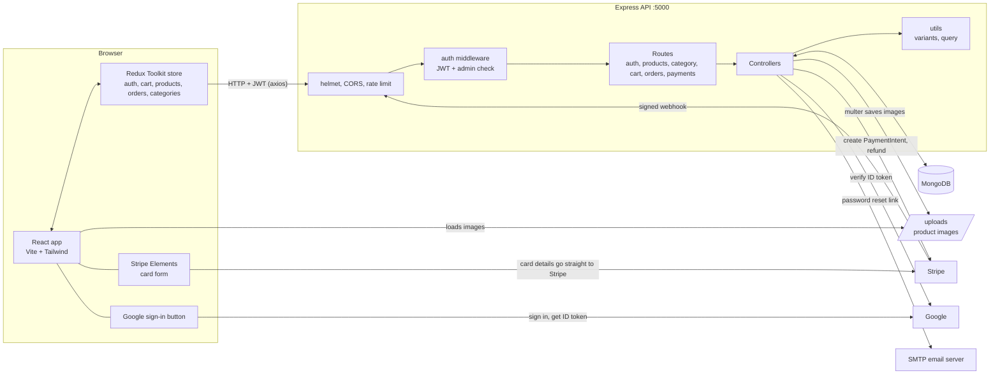
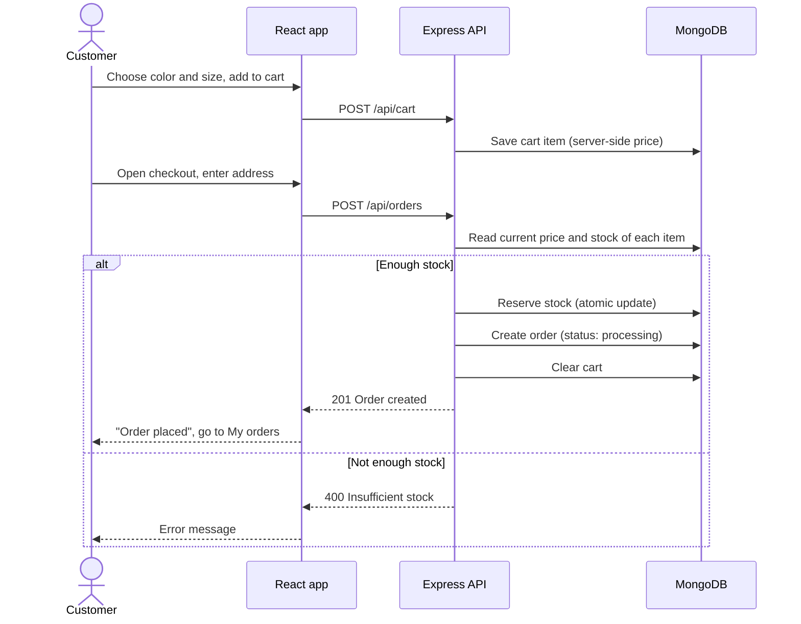
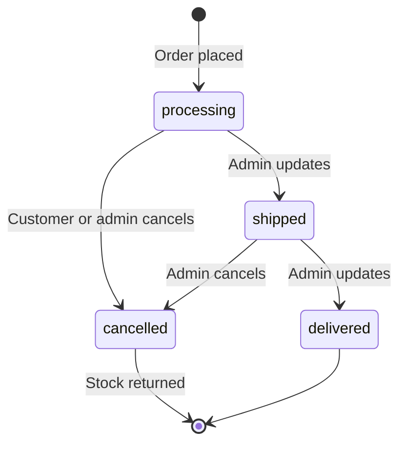
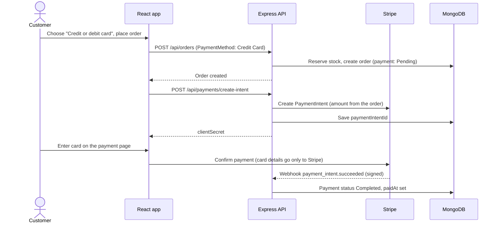
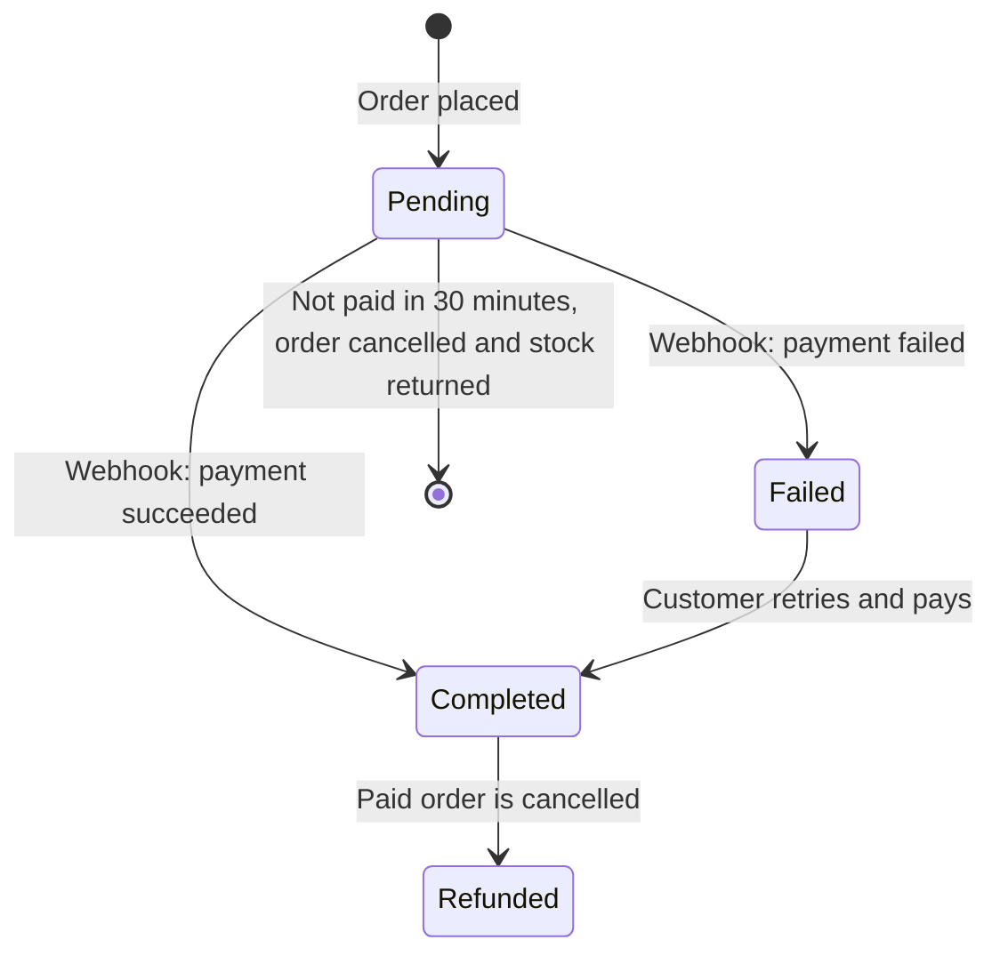
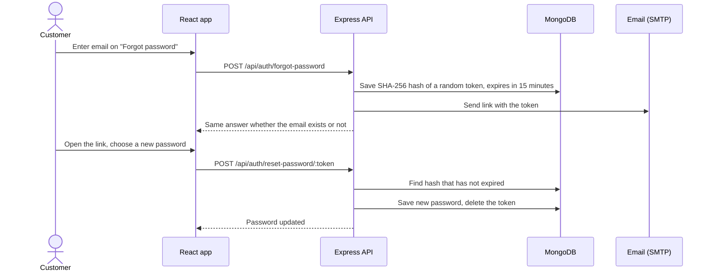
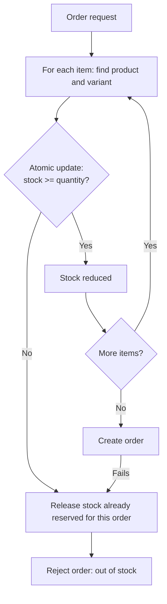
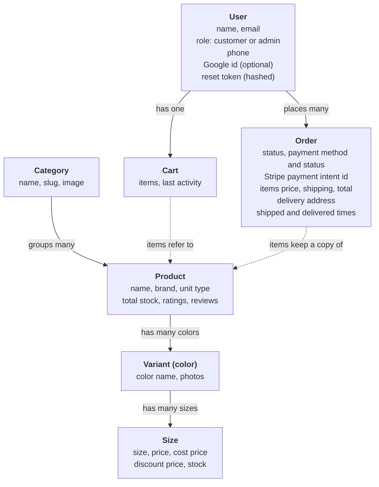

# Bazaaro

A full-stack online store for everyday products, built with the **MERN stack** (MongoDB, Express, React, Node.js). Bazaaro has a **multi-variant inventory system**: every product can have several colors, and every color several sizes, with its own price, stock and photos per size and color. Customers sign in with email or Google, browse, order and pay by card (Stripe, test mode) or cash on delivery. Admins manage products, orders and users from a separate dashboard.

  

---

## Table of contents

- [Features](#features)
- [Tech stack](#tech-stack)
- [Architecture](#architecture)
- [How an order flows](#how-an-order-flows)
- [Card payments (Stripe)](#card-payments-stripe)
- [Sign in and password reset](#sign-in-and-password-reset)
- [Stock safety](#stock-safety)
- [Data model](#data-model)
- [Project structure](#project-structure)
- [Getting started](#getting-started)
- [Environment variables](#environment-variables)
- [API overview](#api-overview)
- [Security](#security)
- [Roadmap](#roadmap)

---

## Features

**Storefront**
- Home page with categories, featured products, products on sale and top-rated products
- Shop page with search, category, price filters and sorting (latest, price, rating). Filters are kept in the URL
- Product page with color and size selection. Price, stock and photos change with the chosen variant
- Image gallery with thumbnails, hover zoom and a full-screen viewer
- Cart that saves automatically, with quantity changes and a free-delivery hint
- Checkout with delivery address. Pay by card (Stripe) or cash on delivery
- Progress steps (Cart, Address, Payment, Done) during checkout
- Secure card form on its own payment page with an order summary, and a "Pay now" button on unpaid orders
- Order history, order details and order cancellation (while the order is still being processed). Cancelling a paid card order refunds it
- Order tracking timeline (placed, processing, shipped, delivered) with the time of each step
- Login, register and "Continue with Google". Forgot password sends a reset link by email
- Profile page
- Loading skeletons, empty states, button spinners and one consistent style for notifications
- Fully responsive (phone, tablet, desktop)

**Admin dashboard**
- Overview with revenue, order, product and category counts and the latest orders
- Products: create, edit and delete, with colors, sizes, prices, stock and multiple photos per color
- Orders: filter by status and update status (processing, shipped, delivered, cancelled). Payment status shows Pending, Completed, Failed or Refunded
- Users: view accounts and delete customers

**Inventory**
- Price and stock are stored per size inside each color
- Stock is reserved when an order is placed and returned if the order is cancelled or fails
- Prices are always read from the database on the server, never trusted from the browser
- Card orders that are not paid within 30 minutes are cancelled automatically and their stock is returned

**Payments**
- Stripe card payments in test mode (PaymentIntent, Stripe Elements, webhooks)
- The amount charged is always the server-side order total
- Order payment status is updated by a signed Stripe webhook, not by the browser

---

## Tech stack

| Layer | Technology |
| --- | --- |
| Frontend | React 19, Vite, Redux Toolkit, React Router, Tailwind CSS, react-hook-form, react-hot-toast |
| Backend | Node.js, Express 4, Mongoose, JWT, bcryptjs, Multer |
| Database | MongoDB |
| Payments | Stripe (PaymentIntents, Stripe Elements, webhooks) |
| Sign in | JWT, bcrypt passwords, Google Sign-In (google-auth-library) |
| Email | Nodemailer over SMTP (Gmail or Resend) |
| Security | helmet, express-rate-limit, CORS allow-list |
| Containers | Docker Compose (MongoDB, API, website served by nginx) |

---

## Architecture



---

## How an order flows



### Order status



The order page shows this as a timeline, with the time of each step. A customer can cancel only while the order is `processing`. A delivered order cannot be cancelled. Cancelling returns the reserved stock, and refunds the payment if a card order was already paid.

---

## Card payments (Stripe)

Card orders reserve stock first, then wait for payment. The browser never decides that an order is paid: only Stripe's signed webhook does.



### Payment status



- Cash on delivery orders become `Completed` when the order is delivered
- Only card and cash on delivery are enabled. Local methods (JazzCash, Easypaisa, bank transfer) are not supported by Stripe in Pakistan and show as "Coming soon"
- If a payment arrives after its order was already cancelled, it is refunded automatically

---

## Sign in and password reset

Customers can sign in with email and password, or with Google. Both ways end with the same login token.

**Google sign-in.** The browser gets an ID token from Google and sends it to the API. The server checks it with Google's public keys (audience must match `GOOGLE_CLIENT_ID`) and accepts only verified emails. If an account with that email exists it is linked, otherwise a new account is created. Accounts made through Google have no password and no phone number until the customer adds one.

**Forgot password.** The reset link contains a random token. Only a hash of the token is stored, so a copy of the database cannot be used to reset anyone's password.



- The link works once and expires after 15 minutes
- Asking for a reset on a Google-only account sends an email that says to use "Continue with Google"
- Reset requests are limited to 5 per hour, and reset attempts to 10 per 15 minutes
- Without SMTP settings the reset link is printed in the server console (development only)

---

## Stock safety

Two customers can try to buy the last item at the same time. Bazaaro avoids overselling by reserving stock with a single atomic database update that only succeeds while enough stock remains.



---

## Data model



Delivery is free for orders over Rs. 1,000, otherwise Rs. 200.

---

## Project structure

```
bazaaro/
├── docker-compose.yml          # MongoDB + API + website in one command
├── docs/
│   └── DOCKER.md               # Docker guide (setup, moving data, troubleshooting)
├── client/                     # React app (Vite)
│   ├── Dockerfile              # build with Vite, serve with nginx
│   ├── nginx.conf
│   ├── public/                 # favicon, placeholder image
│   └── src/
│       ├── components/
│       │   ├── admin/          # shared admin UI (header, table, stat card)
│       │   ├── common/         # Navbar, Footer, Logo, Pagination, dialogs, skeletons,
│       │   │                   # empty state, checkout steps, order timeline, Google button
│       │   └── products/       # ProductCard, ProductGallery (zoom)
│       ├── pages/
│       │   ├── shop/           # Home, Shop, Product detail
│       │   ├── cart/           # Cart
│       │   ├── order/          # Checkout, Payment, My orders, Order detail
│       │   ├── auth/           # Login, Register, Profile, Forgot and reset password
│       │   └── admin/          # Dashboard, Products, Orders, Users
│       ├── redux/slices/       # auth, cart, product, order, category
│       ├── services/           # axios instance
│       └── utils/              # image url, price, status helpers
└── server/
    ├── Dockerfile
    ├── config/                 # database connection
    ├── controller/             # request handlers (orders, payment and webhook, ...)
    ├── middleware/             # JWT and admin checks
    ├── models/                 # Mongoose schemas
    ├── routes/                 # API routes
    ├── scripts/                # one-time maintenance scripts
    ├── utils/                  # variant stock logic, query helpers, Stripe client, mailer
    └── server.js               # app entry point
```

---

## Getting started

**Requirements:** Node.js 22 and MongoDB (local install or Docker). To run everything in containers you only need Docker, see [Run everything with Docker](#run-everything-with-docker-optional).

### 1. Clone

```bash
git clone https://github.com/bilawal-tech/bazaaro.git
cd bazaaro
```

### 2. Start MongoDB

With Docker:

```bash
docker run -d --name bazaaro-mongo -p 27017:27017 mongo:7
```

### 3. Run the server

```bash
cd server
npm install
cp .env.example .env        # Windows PowerShell: copy .env.example .env
```

Open `server/.env` and set `MONGO_URI` and `JWT_SECRET`. Generate one with:

```bash
node -e "console.log(require('crypto').randomBytes(48).toString('hex'))"
```

Then start the API:

```bash
npm run dev                 # http://localhost:5000
```

### 4. Run the client

```bash
cd client
npm install
cp .env.example .env        # footer links and the Stripe publishable key
npm run dev                 # http://localhost:5173
```

Restart `npm run dev` after changing `client/.env`.

### 5. Create an admin account

Register a normal account on the website, then change its role in MongoDB:

```bash
docker exec -it bazaaro-mongo mongosh bazaaro --eval 'db.users.updateOne({ email: "you@example.com" }, { $set: { role: "admin" } })'
```

On Windows PowerShell, use double quotes outside and escape `$set`:

```powershell
docker exec bazaaro-mongo mongosh bazaaro --eval "db.users.updateOne({email:'you@example.com'},{`$set:{role:'admin'}})"
```

Log in again and the **Admin** bar appears under the navigation.

### 6. Set up Stripe (test mode)

Card payments need a free Stripe account. Use **test mode** (a sandbox), never live keys.

1. In the Stripe Dashboard, open Developers, then API keys. Copy the **secret key** (`sk_test_...`) into `server/.env` as `STRIPE_SECRET_KEY`, and the **publishable key** (`pk_test_...`) into `client/.env` as `VITE_STRIPE_PUBLISHABLE_KEY`. The secret key must never go in the client.
2. Install the [Stripe CLI](https://docs.stripe.com/stripe-cli) and log in with the sandbox account: `stripe login`.
3. Forward webhooks to your local server and keep this running:

```bash
stripe listen --events payment_intent.succeeded,payment_intent.payment_failed --forward-to localhost:5000/api/payments/webhook
```

4. Copy the `whsec_...` signing secret it prints into `server/.env` as `STRIPE_WEBHOOK_SECRET`, then restart the server.
5. Pay with the test card `4242 4242 4242 4242`, any future expiry date and any CVC. The order shows `Completed` once the webhook arrives.

If Stripe rejects PKR for your account, set `PAYMENT_CURRENCY=usd` and `PKR_PER_USD` in `server/.env`.

### 7. Set up Google sign-in and password reset emails (optional)

Both are optional. Without them the Google button is hidden, and reset links are printed in the server console.

**Google sign-in**

1. In [Google Cloud Console](https://console.cloud.google.com), create a project. Under APIs & Services, set up the OAuth consent screen (External) and add your Google account as a test user.
2. Under Credentials, create an **OAuth client ID** of type **Web application**. Add `http://localhost:5173` to **Authorized JavaScript origins**. No redirect URI is needed.
3. Put the Client ID in `server/.env` as `GOOGLE_CLIENT_ID` and in `client/.env` as `VITE_GOOGLE_CLIENT_ID`. Restart both.

**Password reset email**

Add SMTP settings to `server/.env`. With Gmail, turn on 2-Step Verification and create an **App Password** for the account:

```
SMTP_HOST=smtp.gmail.com
SMTP_PORT=587
SMTP_USER=you@gmail.com
SMTP_PASS=<16 character app password, no spaces>
EMAIL_FROM=Bazaaro <you@gmail.com>
```

Restart the server. Resend works too (`SMTP_HOST=smtp.resend.com`, `SMTP_USER=resend`, `SMTP_PASS=<API key>`), but it needs a verified domain.

### Run everything with Docker (optional)

One command starts MongoDB, the API and the website:

```bash
docker compose up --build
```

The website is at http://localhost:5173 and the API at http://localhost:5000. Your keys are read from `server/.env`, and `client/.env` is read when the website image is built. Stop the old `bazaaro-mongo` container first, because both use port 27017. Moving old data, demo products and making an admin are explained in [docs/DOCKER.md](docs/DOCKER.md).

### Useful commands

| Where | Command | What it does |
| --- | --- | --- |
| `server` | `npm run dev` | Start the API with auto-reload |
| `server` | `npm start` | Start the API |
| `client` | `npm run dev` | Start the Vite dev server |
| `client` | `npm run build` | Production build into `client/dist` |
| `client` | `npm run lint` | Run ESLint |
| root | `docker compose up --build` | Run MongoDB, the API and the website in containers |
| root | `docker compose down` | Stop the containers (data is kept) |

---

## Environment variables

**Server (`server/.env`)**

| Variable | Required | Description |
| --- | --- | --- |
| `JWT_SECRET` | Yes | Secret used to sign login tokens. The server will not start without it |
| `MONGO_URI` | Yes | MongoDB connection string, for example `mongodb://localhost:27017/bazaaro` |
| `PORT` | No | API port (default `5000`) |
| `JWT_EXPIRES_IN` | No | Token lifetime (default `7d`) |
| `CLIENT_URL` | No | Allowed frontend origin(s), comma separated (default `http://localhost:5173`) |
| `RATE_LIMIT_MAX` | No | Max API requests per IP per 15 minutes (default `600`) |
| `RATE_LIMIT_DISABLED` | No | Set to `true` for load tests |
| `STRIPE_SECRET_KEY` | For card payments | Stripe secret key (`sk_test_...`). Without it, card payments return 503 |
| `STRIPE_WEBHOOK_SECRET` | For card payments | Webhook signing secret (`whsec_...`). Without it, orders stay `Pending` |
| `PAYMENT_CURRENCY` | No | `pkr` (default) or `usd` |
| `PKR_PER_USD` | With `usd` | Exchange rate used when `PAYMENT_CURRENCY=usd` (default `280`) |
| `UNPAID_ORDER_MINUTES` | No | Minutes before an unpaid card order is cancelled (default `30`) |
| `GOOGLE_CLIENT_ID` | For Google sign-in | OAuth client ID. Without it, `POST /auth/google` returns 503 |
| `SMTP_HOST`, `SMTP_PORT`, `SMTP_USER`, `SMTP_PASS` | For reset emails | SMTP server and login (port default `587`). Without `SMTP_HOST`, reset links are printed in the console. In production the server refuses to send without it |
| `EMAIL_FROM` | No | Sender shown on emails, for example `Bazaaro <you@gmail.com>` |

**Client (`client/.env`)**

| Variable | Description |
| --- | --- |
| `VITE_BACKEND_URL` | API server URL (default `http://localhost:5000`) |
| `VITE_SUPPORT_EMAIL`, `VITE_SUPPORT_PHONE` | Shown in the footer when set |
| `VITE_INSTAGRAM_URL`, `VITE_FACEBOOK_URL`, `VITE_X_URL` | Footer social links. Empty values are hidden |
| `VITE_STRIPE_PUBLISHABLE_KEY` | Stripe publishable key (`pk_test_...`) for the card form. Never put the secret key here |
| `VITE_GOOGLE_CLIENT_ID` | Google OAuth client ID (same as the server one). Empty hides the Google button |

With Docker Compose, `MONGO_URI`, `PORT` and `CLIENT_URL` are set by `docker-compose.yml`. Everything else still comes from `server/.env`.

Never commit `.env` files. Only `.env.example` files, which hold placeholders, belong in Git.

---

## API overview

All routes start with `/api`. Routes marked **auth** need a login token, and **admin** needs an admin account.

| Area | Method and route | Access |
| --- | --- | --- |
| Auth | `POST /auth/register`, `POST /auth/login`, `POST /auth/google` | Public |
| | `POST /auth/forgot-password`, `POST /auth/reset-password/:token` | Public |
| | `GET /auth/profile`, `PUT /auth/profile` | Auth |
| | `GET /auth/users`, `DELETE /auth/users/:id` | Admin |
| Products | `GET /products`, `GET /products/:id`, `GET /products/slug/:slug` | Public |
| | `POST /products`, `PUT /products/:id`, `DELETE /products/:id` | Admin |
| | `POST /products/:id/reviews`, `DELETE /products/:id/reviews` | Auth |
| Categories | `GET /category/all`, `GET /category/:slug` | Public |
| | `POST /category/create`, `PUT /category/:id`, `DELETE /category/:id` | Admin |
| Cart | `GET /cart`, `POST /cart`, `PUT /cart/:itemId`, `DELETE /cart/:itemId`, `DELETE /cart` | Auth |
| Orders | `POST /orders`, `GET /orders/my`, `GET /orders/:id`, `PUT /orders/:id/cancel` | Auth |
| | `GET /orders`, `PUT /orders/:id/status` | Admin |
| Payments | `POST /payments/create-intent` | Auth |
| | `POST /payments/webhook` | Stripe only (signature checked) |

Product list query options: `page`, `limit`, `search`, `category`, `minprice`, `maxprice`, `sortby`, `instock`.

---

## Security

- Passwords are hashed with bcrypt, and login uses signed JWT tokens
- Google ID tokens are verified on the server (audience check, verified emails only)
- Password reset tokens are random, stored only as a hash, expire after 15 minutes and work once. The forgot password answer is the same whether the email exists or not
- Admin routes are checked on the server, not only hidden in the interface
- `helmet` security headers and a CORS allow-list (`CLIENT_URL`)
- Rate limits on the whole API, and stricter limits on login (10 failed tries per 15 minutes), register (10 per hour) and password reset
- Request body size limit, search input escaped, page size capped
- Image uploads are limited to JPG, PNG, WEBP, AVIF or GIF, 5 MB each, and the uploads folder is kept out of Git
- Prices and totals are calculated on the server
- Card details never reach the server: the card form talks directly to Stripe
- The charged amount comes from the server-side order, and the webhook signature is verified before any order is marked paid
- The Stripe secret key stays on the server only
- Docker images do not contain `.env` files. Keys are given to the containers when they start

---

## Roadmap

- Local payment methods (JazzCash, Easypaisa, bank transfer). Stripe does not support them in Pakistan, so they show as "Coming soon"
- Delivery riders with live order tracking
- Analytics and reporting on orders, stock and delivery, fed by an event pipeline (Kafka, Spark, Airflow)
- Deployment with CI/CD

---

## Author

Built by **Bilawal Azeem**.